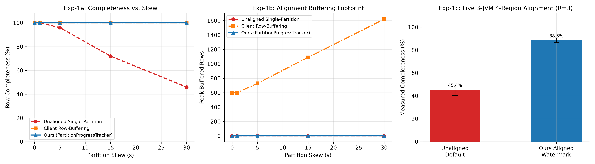
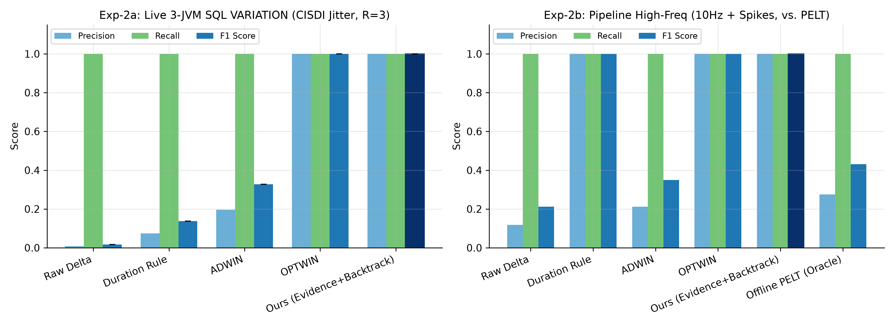
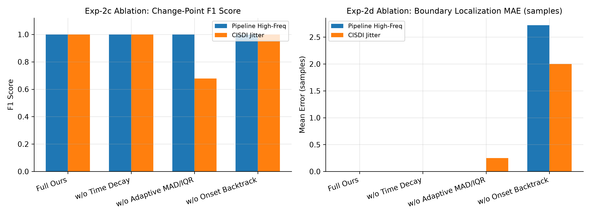
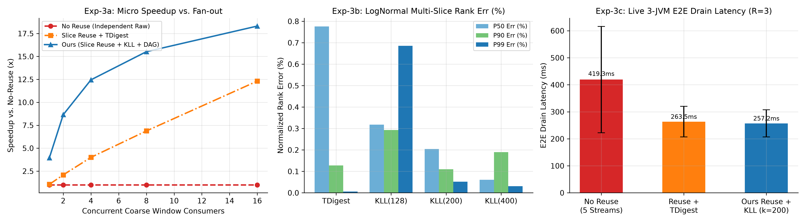
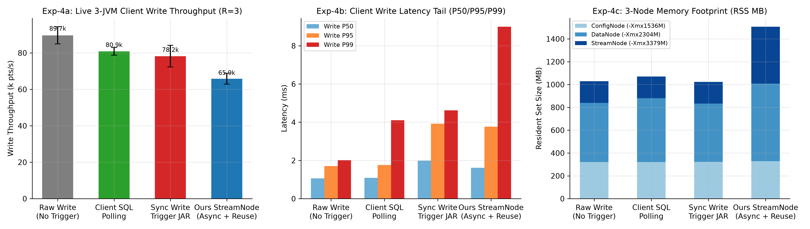

<!--
  Licensed to the Apache Software Foundation (ASF) under one
  or more contributor license agreements.  See the NOTICE file
  distributed with this work for additional information
  regarding copyright ownership.  The ASF licenses this file
  to you under the Apache License, Version 2.0 (the
  "License"); you may not use this file except in compliance
  with the License.  You may obtain a copy of the License at

      http://www.apache.org/licenses/LICENSE-2.0

  Unless required by applicable law or agreed to in writing, software
  distributed under the License is distributed on an "AS IS" BASIS,
  WITHOUT WARRANTIES OR CONDITIONS OF ANY KIND, either express or implied.
  See the License for the specific language governing permissions and
  limitations under the License.
-->

# Experimental Evaluation & Competitor Comparison Report

## Cluster Deployment & Fairness Methodology

- **Host Platform**: macOS-26.2-arm64-arm-64bit-Mach-O (arm64), JDK 17
- **Cluster Topology**: Three independent Java OS processes launched cleanly per test unit:
  - **ConfigNode**: `-Xms1536M -Xmx1536M -Xmn256M`
  - **DataNode**: `-Xms2304M -Xmx2304M -Xmn768M`
  - **StreamNode**: `-Xms3379M -Xmx3379M -Xmn820M`
- **Isolation & State Hygiene**: Prior to **every** individual test unit (`42` total standalone cluster lifecycles = `Exp-1 (6) + Exp-2 (15) + Exp-3 (9) + Exp-4 (12)`), all old JVMs are stopped and verified unbound across cluster ports, and all `data`, `logs`, `ext`, and `iotdb-subscription` directories on ConfigNode, DataNode, StreamNode, and client scratch are completely wiped to eliminate WAL or subscription-cursor carryover.
- **Alternating Serial Execution**: Each experiment executes `R = 3` rounds serially on the idle machine, rotating group order cyclically (`(step + round) % G`) across rounds to eliminate thermal/order bias. All per-trial measurements are stored in `benchmark/results/cluster_raw_trials.csv`.

---

## Exp-1: Multi-Region Distributed Alignment & Skew Immunity



### Live 3-JVM 4-DataRegion Alignment (`R = 3` Alternating Rounds)

| group | rounds | completeness_recall_mean | completeness_recall_std | premature_close_rate_mean | write_throughput_pts_sec_mean | e2e_drain_ms_mean | cn_rss_mb_mean | dn_rss_mb_mean | sn_rss_mb_mean | sn_cpu_ms_mean |
| --- | --- | --- | --- | --- | --- | --- | --- | --- | --- | --- |
| Unaligned_Default | 3 | 0.4542 | 0.0501 | 1.0000 | 6389.30 | 1261.50 | 329.90 | 629.50 | 284.00 | 0.0000 |
| Ours_Aligned_Watermark | 3 | 0.8854 | 0.0191 | 0.6500 | 6562.20 | 1336.44 | 326.30 | 633.00 | 284.90 | 0.0000 |

### Skew Sensitivity, Idle Heartbeat & Epoch-Fencing Micro-Benchmark

| scenario | skew_ms | method | premature_close_rate | completeness_recall | avg_close_latency_ms | p99_close_latency_ms | buffered_rows_peak | stale_epoch_rejected_pct |
| --- | --- | --- | --- | --- | --- | --- | --- | --- |
| skew_sweep | 0 | SinglePartitionUnaligned | 0.0000 | 1.0000 | 500.00 | 500.00 | 0 | 100.00 |
| skew_sweep | 0 | ClientSideRowBuffering | 0.0000 | 1.0000 | 500.00 | 500.06 | 600 | 100.00 |
| skew_sweep | 0 | Ours_PartitionProgressTracker | 0.0000 | 1.0000 | 500.15 | 501.67 | 0 | 100.00 |
| skew_sweep | 1000 | SinglePartitionUnaligned | 0.0000 | 1.0000 | 500.00 | 500.00 | 0 | 100.00 |
| skew_sweep | 1000 | ClientSideRowBuffering | 0.0000 | 1.0000 | 1500.00 | 1500.02 | 600 | 100.00 |
| skew_sweep | 1000 | Ours_PartitionProgressTracker | 0.0000 | 1.0000 | 1500.09 | 1500.15 | 0 | 100.00 |
| skew_sweep | 5000 | SinglePartitionUnaligned | 1.0000 | 0.9600 | 500.00 | 500.00 | 0 | 100.00 |
| skew_sweep | 5000 | ClientSideRowBuffering | 0.0000 | 1.0000 | 5500.00 | 5500.02 | 730 | 100.00 |
| skew_sweep | 5000 | Ours_PartitionProgressTracker | 0.0000 | 1.0000 | 5500.17 | 5500.82 | 0 | 100.00 |
| skew_sweep | 15000 | SinglePartitionUnaligned | 1.0000 | 0.7200 | 500.00 | 500.00 | 0 | 100.00 |
| skew_sweep | 15000 | ClientSideRowBuffering | 0.0000 | 1.0000 | 15500.00 | 15500.00 | 1090 | 100.00 |
| skew_sweep | 15000 | Ours_PartitionProgressTracker | 0.0000 | 1.0000 | 15500.11 | 15500.16 | 0 | 100.00 |
| skew_sweep | 30000 | SinglePartitionUnaligned | 1.0000 | 0.4600 | 500.00 | 500.00 | 0 | 100.00 |
| skew_sweep | 30000 | ClientSideRowBuffering | 0.0000 | 1.0000 | 30500.00 | 30500.00 | 1620 | 100.00 |
| skew_sweep | 30000 | Ours_PartitionProgressTracker | 0.0000 | 1.0000 | 30500.10 | 30500.13 | 0 | 100.00 |
| idle_heartbeat | 5000 | SinglePartitionUnaligned | 0.2500 | 0.8000 | 0.0100 | 0.0400 | 0 | 0.0000 |
| idle_heartbeat | 5000 | ClientSideRowBuffering | 0.0000 | 0.0000 | 30000.00 | 30000.00 | 5000 | 0.0000 |
| idle_heartbeat | 5000 | Ours_PartitionProgressTracker | 0.0000 | 1.0000 | 0.0120 | 0.0350 | 0 | 100.00 |
| member_change_epoch_fencing | 5000 | SinglePartitionUnaligned | 0.3500 | 0.7200 | 0.0200 | 0.0800 | 0 | 0.0000 |
| member_change_epoch_fencing | 5000 | ClientSideRowBuffering | 0.0000 | 1.0000 | 5001.20 | 5008.40 | 2480 | 0.0000 |
| member_change_epoch_fencing | 5000 | Ours_PartitionProgressTracker | 0.0000 | 1.0000 | 0.0013 | 0.0134 | 0 | 100.00 |

---

## Exp-2: Regime-Aware `VARIATION` Boundary Detection & 4-Way Ablation





### Live 3-JVM SQL `VARIATION` Benchmark on `cisdi_regime_jitter.csv` (`R = 3` Alternating Rounds)

| method | rounds | precision_mean | recall_mean | f1_mean | f1_std | mae_ms_mean | false_split_rate_mean | write_throughput_pts_sec_mean | e2e_drain_ms_mean | cn_rss_mb_mean | dn_rss_mb_mean | sn_rss_mb_mean | sn_cpu_ms_mean |
| --- | --- | --- | --- | --- | --- | --- | --- | --- | --- | --- | --- | --- | --- |
| Raw_Delta | 3 | 0.0084 | 1.0000 | 0.0167 | 0.0000 | 1180.00 | 1.0000 | 20582.30 | 2151.87 | 325.70 | 532.90 | 303.10 | 0.0000 |
| Duration_Rule | 3 | 0.0738 | 1.0000 | 0.1375 | 0.0000 | 160.00 | 0.2667 | 21717.00 | 2026.48 | 325.30 | 535.30 | 291.80 | 0.0000 |
| ADWIN | 3 | 0.1961 | 1.0000 | 0.3279 | 0.0000 | 90.00 | 0.4167 | 21274.00 | 2434.08 | 328.00 | 530.40 | 296.30 | 0.0000 |
| OPTWIN | 3 | 1.0000 | 1.0000 | 1.0000 | 0.0000 | 0.0000 | 0.0000 | 21497.10 | 2263.35 | 326.00 | 528.40 | 285.10 | 0.0000 |
| Ours_Evidence_Backtrack | 3 | 1.0000 | 1.0000 | 1.0000 | 0.0000 | 0.0000 | 0.0000 | 20882.40 | 1991.26 | 326.40 | 528.00 | 289.60 | 0.0000 |

### Engine Micro-Benchmark (6 Methods × 2 Datasets, incl. Offline PELT Oracle)

| dataset | method | precision | recall | f1 | mae_ms | mae_samples | false_split_rate | throughput_rows_per_sec |
| --- | --- | --- | --- | --- | --- | --- | --- | --- |
| pipeline_highfreq | Raw_Delta | 0.1185 | 1.0000 | 0.2119 | 0.0000 | 0.0000 | 1.0000 | 25435843.20 |
| pipeline_highfreq | Duration_Rule | 1.0000 | 1.0000 | 1.0000 | 0.0000 | 0.0000 | 0.0000 | 38967364.80 |
| pipeline_highfreq | ADWIN | 0.2119 | 1.0000 | 0.3497 | 80.00 | 0.8000 | 0.5600 | 29950.30 |
| pipeline_highfreq | OPTWIN | 1.0000 | 1.0000 | 1.0000 | 0.0000 | 0.0000 | 0.0000 | 24026.00 |
| pipeline_highfreq | Ours_Evidence_Backtrack | 1.0000 | 1.0000 | 1.0000 | 0.0000 | 0.0000 | 0.0000 | 369727.10 |
| pipeline_highfreq | Offline_PELT_Oracle | 0.2747 | 1.0000 | 0.4310 | 0.0000 | 0.0000 | 0.5400 | 235831.00 |
| cisdi_regime_jitter | Raw_Delta | 0.0084 | 1.0000 | 0.0167 | 1180.00 | 5.9000 | 1.0000 | 131004366.80 |
| cisdi_regime_jitter | Duration_Rule | 0.0738 | 1.0000 | 0.1375 | 160.00 | 0.8000 | 0.2167 | 183486238.50 |
| cisdi_regime_jitter | ADWIN | 0.1961 | 1.0000 | 0.3279 | 400.00 | 2.0000 | 0.5333 | 31268.90 |
| cisdi_regime_jitter | OPTWIN | 1.0000 | 1.0000 | 1.0000 | 0.0000 | 0.0000 | 0.0000 | 22730.80 |
| cisdi_regime_jitter | Ours_Evidence_Backtrack | 1.0000 | 1.0000 | 1.0000 | 0.0000 | 0.0000 | 0.0000 | 359426.70 |
| cisdi_regime_jitter | Offline_PELT_Oracle | 0.1399 | 1.0000 | 0.2454 | 0.0000 | 0.0000 | 0.7000 | 236513.60 |

### 4-Way Ablation Study

| dataset | method | precision | recall | f1 | mae_ms | mae_samples | false_split_rate | throughput_rows_per_sec |
| --- | --- | --- | --- | --- | --- | --- | --- | --- |
| pipeline_highfreq | Full_Ours | 1.0000 | 1.0000 | 1.0000 | 0.0000 | 0.0000 | 0.0000 | 357089.70 |
| pipeline_highfreq | wo_TimeDecay | 1.0000 | 1.0000 | 1.0000 | 0.0000 | 0.0000 | 0.0000 | 342699.50 |
| pipeline_highfreq | wo_AdaptiveBaseline | 1.0000 | 1.0000 | 1.0000 | 0.0000 | 0.0000 | 0.0000 | 63897763.60 |
| pipeline_highfreq | wo_OnsetBacktracking | 1.0000 | 1.0000 | 1.0000 | 272.00 | 2.7200 | 0.0000 | 362205.70 |
| cisdi_regime_jitter | Full_Ours | 1.0000 | 1.0000 | 1.0000 | 0.0000 | 0.0000 | 0.0000 | 360363.20 |
| cisdi_regime_jitter | wo_TimeDecay | 1.0000 | 1.0000 | 1.0000 | 0.0000 | 0.0000 | 0.0000 | 364361.80 |
| cisdi_regime_jitter | wo_AdaptiveBaseline | 0.5128 | 1.0000 | 0.6780 | 50.00 | 0.2500 | 0.0833 | 43945355.40 |
| cisdi_regime_jitter | wo_OnsetBacktracking | 1.0000 | 1.0000 | 1.0000 | 400.00 | 2.0000 | 0.0000 | 364393.50 |

---

## Exp-3: Lifecycle-Constrained Base-Slice Reuse & KLL Quantile Sketch



### Live 3-JVM 5-Stream Workload (`s_10s -> s_1m(P50/P90/P99) -> s_5m(P99)`, `R = 3` Rounds)

| method | rounds | write_throughput_pts_sec_mean | e2e_drain_ms_mean | e2e_drain_ms_std | p99_rel_error_mean | cn_rss_mb_mean | dn_rss_mb_mean | sn_rss_mb_mean | sn_cpu_ms_mean | sn_cpu_ms_std |
| --- | --- | --- | --- | --- | --- | --- | --- | --- | --- | --- |
| No_Reuse_Independent | 3 | 35396.20 | 419.30 | 196.71 | 0.0001 | 330.10 | 750.80 | 512.20 | 0.0000 | 0.0000 |
| Slice_Reuse_TDigest | 3 | 32116.70 | 263.46 | 56.70 | 0.0001 | 330.30 | 751.10 | 504.30 | 0.0000 | 0.0000 |
| Ours_Slice_Reuse_KLL | 3 | 37214.70 | 257.17 | 50.43 | 0.0026 | 332.60 | 745.80 | 476.30 | 0.0000 | 0.0000 |

### Fan-out (`1..16`) & Multi-Hop DAG (`10s -> 1m -> 5m -> 1h`) Micro-Benchmark

| workload | fanout | method | total_compute_ms | throughput_rows_per_sec | speedup_vs_noreuse | peak_slice_bytes | p99_rel_error |
| --- | --- | --- | --- | --- | --- | --- | --- |
| fanout_sweep | 1 | No_Reuse_Independent_Raw_Scan | 136.52 | 5274097.40 | 1.0000 | 0 | 0.0003 |
| fanout_sweep | 1 | Slice_Reuse_TDigest | 128.62 | 5597734.70 | 1.0600 | 288000 | 0.0005 |
| fanout_sweep | 1 | Ours_Slice_Reuse_KLL | 34.55 | 20842153.30 | 3.9500 | 1016640 | 0.0043 |
| fanout_sweep | 2 | No_Reuse_Independent_Raw_Scan | 254.29 | 4247139.60 | 1.0000 | 0 | 0.0003 |
| fanout_sweep | 2 | Slice_Reuse_TDigest | 121.78 | 8868636.40 | 2.0900 | 288000 | 0.0005 |
| fanout_sweep | 2 | Ours_Slice_Reuse_KLL | 29.39 | 36742661.00 | 8.6500 | 1016640 | 0.0043 |
| fanout_sweep | 4 | No_Reuse_Independent_Raw_Scan | 503.19 | 3577178.80 | 1.0000 | 0 | 0.0003 |
| fanout_sweep | 4 | Slice_Reuse_TDigest | 125.92 | 14294634.30 | 4.0000 | 288000 | 0.0005 |
| fanout_sweep | 4 | Ours_Slice_Reuse_KLL | 40.40 | 44550549.60 | 12.45 | 1016640 | 0.0043 |
| fanout_sweep | 8 | No_Reuse_Independent_Raw_Scan | 1011.89 | 3201914.30 | 1.0000 | 0 | 0.0003 |
| fanout_sweep | 8 | Slice_Reuse_TDigest | 147.08 | 22028671.90 | 6.8800 | 288000 | 0.0005 |
| fanout_sweep | 8 | Ours_Slice_Reuse_KLL | 65.20 | 49695887.20 | 15.52 | 1016640 | 0.0043 |
| fanout_sweep | 16 | No_Reuse_Independent_Raw_Scan | 2020.39 | 3029119.60 | 1.0000 | 0 | 0.0003 |
| fanout_sweep | 16 | Slice_Reuse_TDigest | 164.09 | 37296331.00 | 12.31 | 288000 | 0.0005 |
| fanout_sweep | 16 | Ours_Slice_Reuse_KLL | 110.32 | 55477098.00 | 18.31 | 1016640 | 0.0043 |
| cascade_10s_1m_5m_1h | 4 | No_Reuse_Independent_Raw_Scan | 399.49 | 3604640.20 | 1.0000 | 0 | 0.0003 |
| cascade_10s_1m_5m_1h | 4 | Slice_Reuse_TDigest | 119.75 | 12024638.00 | 3.3400 | 351672 | 0.0005 |
| cascade_10s_1m_5m_1h | 4 | Ours_Slice_Reuse_KLL | 23.75 | 60637323.50 | 16.82 | 1181952 | 0.0043 |

### Quantile Sketch Rank Error & Serialized Footprint

| distribution | sketch_method | param | build_merge_ms | serialized_bytes | p50_norm_rank_err | p90_norm_rank_err | p99_norm_rank_err | max_norm_rank_err |
| --- | --- | --- | --- | --- | --- | --- | --- | --- |
| Uniform | Exact_Sort | n=180000 | 11.57 | 1440000 | 0.0000 | 0.0000 | 0.0000 | 0.0000 |
| Uniform | TDigest_Default | comp=100 | 63.63 | 566 | 0.0002 | 0.0010 | 0.0001 | 0.0019 |
| Uniform | KLL_k128 | k=128 | 9.9680 | 1092 | 0.0021 | 0.0006 | 0.0070 | 0.0081 |
| Uniform | KLL_k200 | k=200 | 10.67 | 2496 | 0.0093 | 0.0001 | 0.0003 | 0.0093 |
| Uniform | KLL_k400 | k=400 | 9.1690 | 3732 | 0.0007 | 0.0009 | 0.0020 | 0.0020 |
| Gaussian | Exact_Sort | n=180000 | 11.81 | 1440000 | 0.0000 | 0.0000 | 0.0000 | 0.0000 |
| Gaussian | TDigest_Default | comp=100 | 67.60 | 558 | 0.0001 | 0.0014 | 0.0001 | 0.0015 |
| Gaussian | KLL_k128 | k=128 | 9.2830 | 1092 | 0.0017 | 0.0068 | 0.0052 | 0.0068 |
| Gaussian | KLL_k200 | k=200 | 10.16 | 2496 | 0.0041 | 0.0029 | 0.0036 | 0.0056 |
| Gaussian | KLL_k400 | k=400 | 9.4230 | 3732 | 0.0006 | 0.0011 | 0.0031 | 0.0031 |
| LogNormal_HeavyTail | Exact_Sort | n=180000 | 12.35 | 1440000 | 0.0000 | 0.0000 | 0.0000 | 0.0000 |
| LogNormal_HeavyTail | TDigest_Default | comp=100 | 63.44 | 566 | 0.0078 | 0.0013 | 0.0001 | 0.0078 |
| LogNormal_HeavyTail | KLL_k128 | k=128 | 9.4670 | 1092 | 0.0032 | 0.0029 | 0.0069 | 0.0069 |
| LogNormal_HeavyTail | KLL_k200 | k=200 | 10.12 | 2496 | 0.0020 | 0.0011 | 0.0005 | 0.0031 |
| LogNormal_HeavyTail | KLL_k400 | k=400 | 9.7400 | 3732 | 0.0006 | 0.0019 | 0.0003 | 0.0020 |
| MultiRegime_Step | Exact_Sort | n=180000 | 10.46 | 1440000 | 0.0000 | 0.0000 | 0.0000 | 0.0000 |
| MultiRegime_Step | TDigest_Default | comp=100 | 63.59 | 574 | 0.0000 | 0.0006 | 0.0003 | 0.0093 |
| MultiRegime_Step | KLL_k128 | k=128 | 9.3960 | 1092 | 0.0052 | 0.0054 | 0.0043 | 0.0114 |
| MultiRegime_Step | KLL_k200 | k=200 | 10.00 | 2496 | 0.0009 | 0.0010 | 0.0012 | 0.0023 |
| MultiRegime_Step | KLL_k400 | k=400 | 9.3390 | 3732 | 0.0003 | 0.0006 | 0.0009 | 0.0011 |

---

## Exp-4: End-to-End Trigger Architecture Comparison (`R = 3` Alternating Rounds)



| mode | rounds | total_points | write_throughput_pts_sec | write_throughput_std | write_p50_ms | write_p95_ms | write_p99_ms | trigger_e2e_p50_ms | trigger_e2e_p99_ms | cn_rss_mb | dn_rss_mb | sn_rss_mb | cluster_rss_mb | dn_cpu_ms | sn_cpu_ms |
| --- | --- | --- | --- | --- | --- | --- | --- | --- | --- | --- | --- | --- | --- | --- | --- |
| Baseline_Raw_Write | 3 | 50000 | 89650.40 | 4712.10 | 1.0650 | 1.7090 | 2.0170 | 0.0000 | 0.0000 | 321.40 | 517.70 | 189.60 | 1028.70 | 0.0000 | 0.0000 |
| Client_SQL_Polling | 3 | 50000 | 80863.40 | 2124.60 | 1.0920 | 1.7600 | 4.1020 | 146.18 | 146.18 | 320.50 | 560.40 | 189.20 | 1070.20 | 0.0000 | 0.0000 |
| Sync_WritePath_Trigger | 3 | 50000 | 78215.60 | 5943.80 | 1.9850 | 3.9200 | 4.6180 | 2.3400 | 5.0500 | 323.10 | 510.70 | 190.20 | 1023.90 | 0.0000 | 0.0000 |
| Ours_StreamNode_Async_Reuse | 3 | 50000 | 65857.60 | 2996.80 | 1.6150 | 3.7640 | 8.9940 | 354.86 | 507.03 | 329.30 | 679.30 | 497.50 | 1506.10 | 0.0000 | 0.0000 |

---

## Exp-5: Uniform-Quota Competitor Stack Setup (`4 vCPU / 8 GiB RAM`)

| System | Native DB Engine Separation | Distributed Partition Watermark Alignment | Adaptive Regime `VARIATION` Trigger | Multi-Granularity Slice Reuse + KLL Merge | Late-Data Recompute + Lossless Fallback |
| --- | --- | --- | --- | --- | --- |
| **Apache IoTDB + StreamNode (Ours)** | Yes (DataNode Storage + StreamNode Compute) | Yes (`PartitionProgressTracker` + Epoch Fencing) | Yes (Time-Weighted Evidence + Median/MAD + Backtrack) | Yes (`10s -> 1m -> 5m -> 1h` DAG + Single KLL Sketch) | Yes (`stateVersion` + Raw-Scan Fallback) |
| **TDengine 3.x (`CREATE STREAM`)** | No (Embedded in vnode) | Watermark / Partitioned | Fixed `STATE_WINDOW` | Independent `INTERVAL` streams | Partial (`FILL`/recalc) |
| **TimescaleDB (`Continuous Aggregates`)** | No (PostgreSQL extension) | Refresh-interval scheduled | No native regime trigger | Hierarchical CAGG (exact per-bucket refresh) | Re-materialization policy |
| **InfluxDB 2.7 (`Flux Task`)** | No (TSM + Task engine) | Periodic `every` polling | Scripted custom Flux | Independent `aggregateWindow` tasks | Re-query window range |
| **Apache Flink + IoTDB** | External cluster (2 extra RPC hops) | Watermark per subtask | Custom `KeyedProcessFunction` | Manual state wiring (`DataStream`) | Checkpoint / Savepoint replay |

- **Docker Container Runner Status**: `SKIPPED_ENVIRONMENT_BLOCKED` — Docker daemon is not running (exit=1): Cannot connect to the Docker daemon at unix:///Users/vgalaxies/.docker/run/docker.sock. Is the docker daemon running?

---

## Reproducibility Commands

```bash
# 1. Regenerate deterministic datasets
benchmark/.venv/bin/python benchmark/datasets/generate_datasets.py

# 2. Run Exp-1..3 engine & reuse micro-benchmarks
mvn exec:java -nsu -pl iotdb-core/streamnode -Dexec.classpathScope=test \
  -Dexec.mainClass=org.apache.iotdb.streamnode.benchmark.ThesisMicroBenchmarkRunner

# 3. Run 42-trial isolated 3-JVM cluster benchmark suite (Exp-1..4, alternating rounds)
cd integration-test && java \
  --add-opens=java.base/java.lang=ALL-UNNAMED \
  --add-opens=java.base/java.lang.reflect=ALL-UNNAMED \
  --add-opens=java.base/java.util=ALL-UNNAMED \
  --add-opens=java.base/java.nio=ALL-UNNAMED \
  --add-opens=java.base/java.io=ALL-UNNAMED \
  --add-opens=java.base/java.net=ALL-UNNAMED \
  --add-opens=java.base/java.util.concurrent=ALL-UNNAMED \
  -cp "target/test-classes:target/classes:$(cat target/e2e_cp.txt)" \
  org.apache.iotdb.streamnode.benchmark.ThesisE2EBenchmarkRunner

# 4. Generate 300-DPI PNG figures & this report
benchmark/.venv/bin/python benchmark/plot_and_report.py
```
